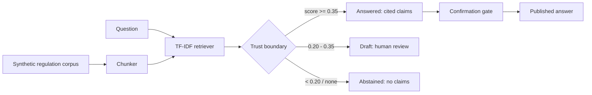

# Finance Compliance RAG — cited answers over synthetic regulations

> **All data is synthetic and fictional.** The firm "Bramley Bank" is an
> invented brand for this demo, not a real institution. The regulation
> texts are invented passages, not real law. Nothing here is legal advice,
> and this project claims no affiliation with any university, course
> provider, bank, or regulator.

## Recruiter summary

Compliance staff need answers they can audit: not just a conclusion, but
the exact passage it came from. This repo builds a small retrieval system
that splits invented regulation text into chunks, retrieves the closest
passages with TF-IDF, and answers only when retrieval is strong enough —
otherwise it refuses and escalates to a human. Proof: 60 tests green, and
a 6-question regression set where all 6 questions are answered with
their known-good source cited, while an unrelated question is refused
with zero claims.

## Purpose and who it is for

For engineers building retrieval systems for regulated work, and for
reviewers who want to see the trust boundary made explicit: what the
system answers, what it drafts for review, and what it refuses. It is a
learning scaffold, not a compliance product. A real deployment would need
real counsel, real source documents, real embeddings, and a real review
workflow — see `docs/limitations.md`.

## How it works, step by step

1. **Chunk.** Each invented regulation document is split into overlapping
   slices (`compliance_rag/chunking.py`). Every slice gets a stable id
   like `BB-CDD-01#0`, which is what citations point at.
2. **Index.** A TF-IDF index is built over the chunks with the standard
   library only (`compliance_rag/retrieval.py`). Common function words
   are dropped so unrelated questions do not score off shared glue words.
3. **Retrieve.** A question is scored against every chunk by cosine
   similarity; the top passages come back ranked.
4. **Answer or refuse.** `compliance_rag/qa.py` applies the trust
   boundary: score ≥ 0.35 → answered with cited claims; 0.20–0.35 →
   draft flagged for human review; below 0.20 (or nothing retrieved) →
   abstained, zero claims, escalation flag set. Every claim's text is an
   exact excerpt of its cited passage, so a reviewer can check it.
5. **Guard.** Answers pass through PII redaction before display, a
   confirmation gate before publication, and a view-only SQLite store
   for the passage catalogue. See `docs/guardrails.md`.

## Architecture



Full diagram: `docs/architecture.md`. Distilled notes: `knowledge/`.

## Real code excerpts and real output

Chunking a document:

```python
from compliance_rag.chunking import chunk_text
chunks = chunk_text("Records must be retained for seven years.", "BB-REC-02")
chunks[0].chunk_id  # 'BB-REC-02#0'
```

Running the demo (`python3 scripts/run_demo.py`) produces, verbatim:

```
Question: How long must identity verification records be kept after an account closes?
Status: answered (confidence 0.466)
Citation [BB-CDD-01#0]: Bramley Bank Customer Due Diligence Standard. Before opening an account, staff must verify the customer's identity from an approved document and record the customer's full name, date of birth, and residential address. Where the customer act
Citation [BB-REC-02#0]: Bramley Bank Record Retention Standard. Compliance records must be stored in a form that can be retrieved within five business days of a request. Records relating to closed accounts must be retained for seven years after closure, and record

Unrelated question -> status: abstained, claims: 0, escalate: True
Reason: no passage retrieved for this question

Regression set (n=6):
  [answered    ] expected BB-CDD-01 cited=['BB-CDD-01', 'BB-REC-02'] :: How long must identity verification records be kept after an
  [answered    ] expected BB-REC-02 cited=['BB-REC-02'] :: How quickly must compliance records be retrievable after a r
  [answered    ] expected BB-AML-03 cited=['BB-AML-03'] :: Within how many business days must staff raise an internal r
  [answered    ] expected BB-KYC-04 cited=['BB-KYC-04'] :: How often must customer risk ratings be reviewed?
  [answered    ] expected BB-TRN-05 cited=['BB-REC-02', 'BB-TRN-05'] :: How often must staff complete refresher compliance training?
  [answered    ] expected BB-AML-03 cited=['BB-AML-03'] :: Must staff tell a customer that a suspicious activity report
```

Note the demo shows a real weakness honestly: the first answer cites a
second passage that is merely related (retention generally), not the
specific identity-verification rule. Citations are checkable, which is
exactly why they are shown — a reviewer can see the extra citation and
discount it. See `docs/limitations.md`.

## How to run (offline first)

```bash
python3 -m pytest tests/ -q   # full suite, stdlib only, no network
python3 scripts/run_demo.py   # cited answer + refusal demo
```

No install step, no virtualenv inside the repo, no credentials, no
network calls. Optional cloud use is **not** provided — see Built vs
planned.

## Guardrails and security controls

- **View-aware SQLite authorizer** (`compliance_rag/store.py`): base-table
  reads denied; only reads through allowed views (`v_passages`,
  `v_sources`) succeed; `sqlite_master`, writes, PRAGMA, ATTACH, and
  `load_extension` denied. Proven by tests that execute real queries
  (no SQL-text inspection shortcut).
- **Confirmation gate** (`compliance_rag/gates.py`): bypass, reject,
  absent-path, low-confidence, and self-contradicting-consent
  ("yes, wait, no") cases all refuse. Approvals are named-person,
  single-use, scoped, and expiring.
- **PII redaction** (`compliance_rag/redaction.py`): card numbers, email
  addresses, phone numbers, and SSNs.
- **Row cap**: `fetchmany(MAX + 1)` at fetch time; no LIMIT rewriting,
  no `fetchall` on capped paths.
- **Cost inputs**: negatives rejected, never silently clamped.
- **Email**: dry-run by default, explicit opt-in to send, refused in CI,
  no credentials in the repo.
- **Brand check**: blocklist stored as SHA-256 hashes only
  (`compliance_rag/brand.py`, `scripts/brand_check.py`).

Full detail: `docs/guardrails.md`, `docs/threat-model.md`.

## Limitations and known failures (kept visible as tests)

- TF-IDF matches shared words, not meaning: synonyms, negation, and
  paraphrase are missed. The swap point for real embeddings is in
  `compliance_rag/retrieval.py` (`Retriever(vectorizer=...)`).
- Thresholds (0.35 answer / 0.20 abstain) were picked on the 6-question
  regression set; they are defaults, not tuned values, and will not
  generalise to a real corpus.
- Citations can include merely-related passages (see the demo output
  above); citation presence is not citation quality.
- The corpus is 5 invented documents; nothing here proves performance
  on real regulations.
- See `docs/limitations.md` for the full list, including the tests that
  encode each known miss.

## Built vs planned

| Area | Status |
|---|---|
| Chunking with overlap + stable citation ids | Built |
| TF-IDF retrieval (stdlib) + embedding swap point | Built |
| Question → cited answer, abstention, human escalation | Built |
| Synthetic corpus (5 docs) + 6-question regression set | Built |
| View-aware SQLite authorizer, row cap | Built |
| Confirmation gate, named/single-use/scoped/expiring approvals | Built |
| PII redaction (cards, emails, phone, SSN) | Built |
| Negative-cost rejection, email dry-run default, brand hash check | Built |
| Real embeddings / vector database | Planned |
| Real regulation corpus, human review UI, audit log store | Planned |
| Deployment, packaging, hosted demo | Planned (not claimed) |

## Tests

60 tests, stdlib only, run with system Python 3 / pytest:

```
60 passed in 0.08s
```

Run: `python3 -m pytest tests/ -q` from the repo root. No `.venv`
inside the repo; no workflow files are included in this scaffold.

## Docs

- `docs/architecture.md` — architecture (Mermaid)
- `docs/how-it-works.md` — step-by-step flow
- `docs/examples.md` — code excerpts with real output
- `docs/running.md` — how to run offline first
- `docs/guardrails.md` — guardrails and security controls
- `docs/limitations.md` — limitations and known failures
- `docs/built-vs-planned.md` — Built / Written-not-run / Planned table
- `docs/implementation-guide.md` — adopter guide
- `docs/interview-points.md` — interview talking points
- `docs/threat-model.md` — threat model and ADRs
- `docs/related-repos.md` — related repos, cross-links not duplication
- `knowledge/` — distilled notes + Mermaid architecture docs

## License and security

MIT — see `LICENSE`. Security policy — see `SECURITY.md`.
