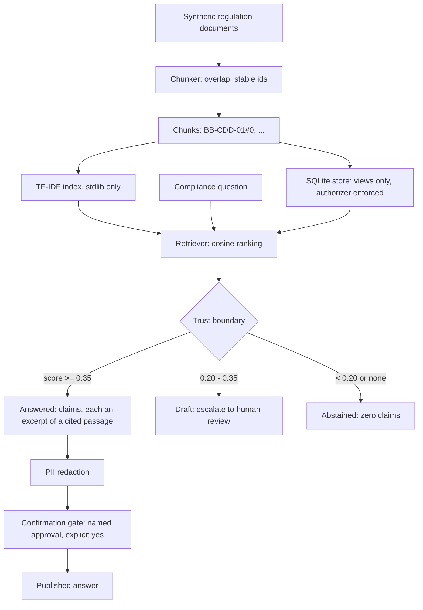

# Architecture

Key design choice: the trust boundary sits *between* retrieval and
answer construction, not after it. A weak retrieval result never reaches
a sentence generator, so there is nothing to hallucinate with — the
refusal path produces no claims at all, by construction, not by asking
a model to be careful.

Swap point: `Retriever` accepts a `vectorizer` callable. Replacing
TF-IDF with real embeddings means passing a different vectorizer, not
rewriting the answer flow. The store is separate: it holds the passage
catalogue behind views, and the authorizer — not application code — is
what enforces view-only access.
